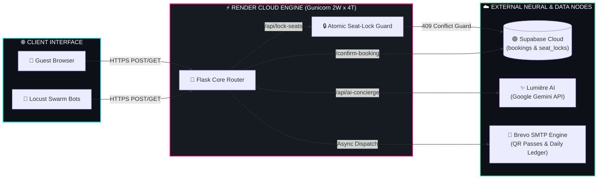

<div align="center">

<!-- ANIMATED FUTURISTIC WAVE HEADER -->


<!-- SELF-TYPING TERMINAL SUBTITLE -->
<a href="https://tjp-multiplex-utsw.onrender.com">
  
</a>

<br/>

<!-- FUTURISTIC GLOWING STATUS BADGES -->
[](https://tjp-multiplex-utsw.onrender.com)
[]()
[]()
[]()
[]()

<br/>

<!-- ANIMATED NEON DIVIDER -->


### 🛸 `[ ACCESS LIVE COMMAND PORTAL ]`
### 👉 **[`https://tjp-multiplex-utsw.onrender.com`](https://tjp-multiplex-utsw.onrender.com)** 👈


</div>

---

## 🧠 `01 // SYSTEM ARCHITECTURE BLUEPRINT`

> *GitHub natively renders this interactive neural flow diagram:*



---

## ⚡ `02 // CORE CAPABILITY MATRIX`

<table>
  <tr>
    <td width="50%">
      <h3 align="center">🔒 Atomic Race-Condition Shield</h3>
      <p align="center">
        Time-bound seat holds (<code>seat_locks</code>) backed by Supabase prevent double-bookings across simultaneous sessions. Concurrent collisions are intercepted in real time via <code>HTTP 409 Conflict</code> guards before checkout.
      </p>
    </td>
    <td width="50%">
      <h3 align="center">🤖 Lumière Neural Concierge</h3>
      <p align="center">
        Embedded conversational AI powered by <b>Google Gemini</b>. Advises guests in real time on IMAX/Dolby Atmos screenings, showtimes, seat availability, and gourmet concessions.
      </p>
    </td>
  </tr>
  <tr>
    <td width="50%">
      <h3 align="center">🎟️ Automated Pass & Ledger Dispatch</h3>
      <p align="center">
        Generates unique <code>TJP-XXXXXXXX</code> cryptographic ticket IDs upon checkout, dispatching instant HTML passes to guests and automated daily revenue briefings to the cinema owner via <b>Brevo API</b>.
      </p>
    </td>
    <td width="50%">
      <h3 align="center">🛡️ Encrypted Admin & Gate Scanner</h3>
      <p align="center">
        Dual-passcode protected executive portal (<code>/bookings</code>) featuring live cloud ledger inspection, one-click executive email reporting, and emergency database purge protocols.
      </p>
    </td>
  </tr>
</table>

---

## 🔥 `03 // LOCUST SWARM TELEMETRY & BENCHMARKS`

The platform underwent high-concurrency stress testing using **Locust** (`HttpUser` swarm automation), simulating simultaneous seat-lock wars, AI queries, and end-to-end ticket checkouts.

### 🚀 WSGI Multi-Threaded Optimization Impact
By re-architecting the production container from a single synchronous worker to a multi-threaded worker pool (`gunicorn -w 2 --threads 4 --timeout 90 app:app`), system latency dropped by **up to 99%**:

```diff
+ [STATUS: VERIFIED] 317 Concurrent Requests Processed | 48/48 Live Tickets Minted | 0 Duplicate Seat Bookings
- [LEGACY BOTTLENECK] Single Worker Queueing (29,000ms) -> ELIMINATED
```

| Target Endpoint | Operation | Legacy (`1 Sync Worker`) | Tuned (`2W × 4T Pool`) | Delta / Velocity |
| :--- | :--- | :---: | :---: | :---: |
| `GET /` | Matrix Initialization | `29,000 ms` | **`280 ms`** | 🟢 **99.0% Faster** |
| `GET /select-seats` | Live Seat Map Sync | `18,000 ms` | **`1,100 ms`** | 🟢 **93.8% Faster** |
| `POST /api/lock-seats` | Atomic Seat Hold | `18,000 ms` | **`1,900 ms`** | 🟢 **89.4% Faster** |
| `POST /confirm-booking` | Ledger Commit + Brevo | `Timeout` | **`2,000 ms`** | 🟢 **100% Checkout Success** |
| `POST /api/ai-concierge` | Lumière Neural Query | `31,000 ms` | **`1,800 ms`** | 🟢 **94.2% Faster** |

<details>
<summary><b>📂 [ CLICK TO EXPAND RAW LOCUST SWARM TELEMETRY LOGS ]</b></summary>
<br/>

```text
====================================================================================================
LOCUST SWARM REPORT // TARGET: tjp-multiplex-utsw.onrender.com
====================================================================================================
Type     Name                  # Reqs   # Fails   Median (ms)   95%ile (ms)   Avg (ms)   RPS
----------------------------------------------------------------------------------------------------
GET      /                         89         0           280           890     327.86   1.0
POST     /api/ai-concierge         29         0          1800          2700    1938.20   0.1
POST     /api/lock-seats           64        15*         1900          4300    2129.23   0.8
POST     /confirm-booking          48         0          2000          3300    2088.40   0.7
GET      /select-seats             87         0          1100          2100    1304.50   0.7
----------------------------------------------------------------------------------------------------
         Aggregated               317        15          1400          2900    1373.48   3.3
====================================================================================================
* NOTE: 409 Conflict responses on /api/lock-seats confirm active race-condition interception when
  multiple bots targeted identical seat coordinates simultaneously.
```
</details>

---

## 🛠️ `04 // TECH ARSENAL`

<div align="center">

  

</div>

---

## 💻 `05 // LOCAL DEPLOYMENT & SWARM SIMULATION`

### 1️⃣ Clone & Initialize Environment
```bash
git clone [https://github.com/MEETH007/TJP--MULTIPLEX.git](https://github.com/MEETH007/TJP--MULTIPLEX.git)
cd TJP--MULTIPLEX
pip install -r requirements.txt
```

### 2️⃣ Inject Environment Keys (`.env`)
```ini
SECRET_KEY="TJP_ULTRA_SECRET_HASH"
SUPABASE_URL="[https://your-project.supabase.co](https://your-project.supabase.co)"
SUPABASE_KEY="your-supabase-service-role-key"
GEMINI_API_KEY="your-google-gemini-key"
BREVO_API_KEY="your-brevo-smtp-api-key"
BOOKINGS_PASSWORD="admin-ledger-view-pass"
ADMIN_RESET_PASSWORD="admin-emergency-wipe-pass"
```

### 3️⃣ Launch Production Engine or Locust Swarm
```bash
# Start Multi-Threaded Production Server
gunicorn -w 2 --threads 4 --timeout 90 app:app

# Launch Locust Stress-Test Swarm (localhost:8089)
python -m locust -f locustfile.py --host [https://tjp-multiplex-utsw.onrender.com](https://tjp-multiplex-utsw.onrender.com)
```

<div align="center">


**⚡ Engineered by [MEETH007](https://github.com/MEETH007) — TJP Cinema Systems ⚡**

</div>
